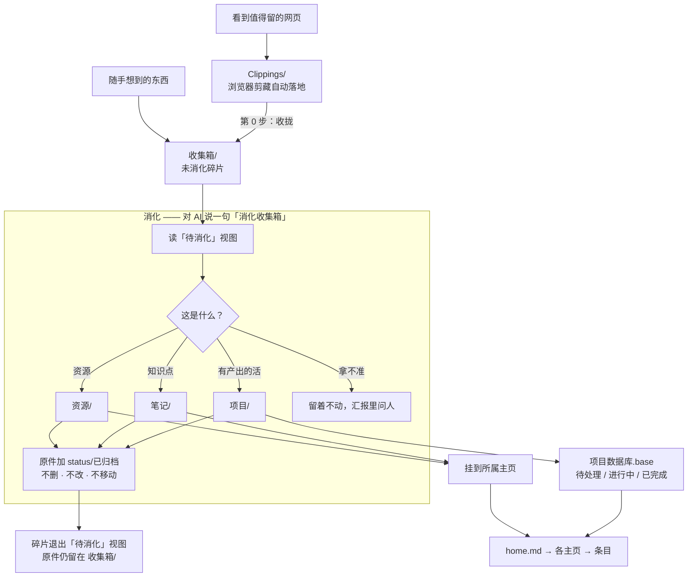
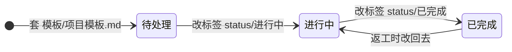

---
up:
  - "[[home]]"
tags:
  - type/MOC
---
# 知识库工作流

> 这个库怎么转起来：东西从哪进来、AI 怎么消化、消化到哪去、项目状态怎么变、人从哪读。

## 一、总流程

## 二、项目状态怎么变

状态写在 frontmatter 的 `tags` 里，**改状态只改这一行**：文件不移动、链接不断、主页不用重挂。

## 三、每一步落在哪

| 环节 | 谁做 | 落在哪 | 由什么约束 |
|---|---|---|---|
| 收进来 | 人（剪藏插件／随手新建） | `Clippings/` → 收拢后进 `收集箱/` | 入口零摩擦，碎片不要求任何 frontmatter |
| 消化 | AI | 读 `数据库/收集箱数据库.base` 的「待消化」视图 | `AGENTS.md` §十 ＋ `收集箱/收集箱.md` 的「消化流程」 |
| 归位 | AI | 套 `模板/` 里的模板，写成新笔记 | §四 字段名不可改；§五 必须挂回主页 |
| 归档 | AI | 给原件加 `status/已归档` | 原件不删、不改、不移动 |
| 阅读 | 人 | `home.md` → 各主页 → `.base` 视图 | 导航层保持人可读：主页管导航，`.base` 管检索 |

## 相关

- [[home|全库首页]]
- [[AGENTS.md|本库的 AI 行为规定]]（规则，不是笔记）
- [[收集箱/收集箱|收集箱]] · [[项目/项目|项目]]
